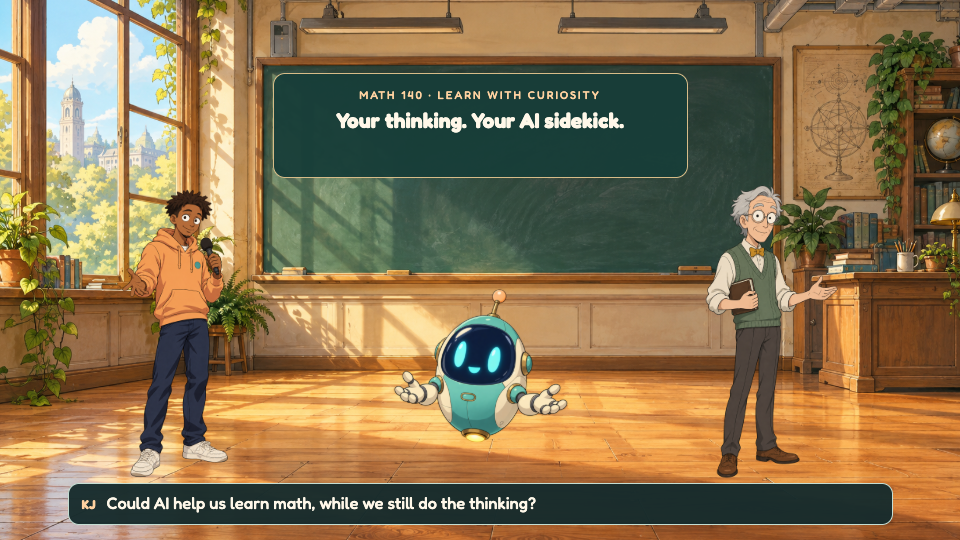
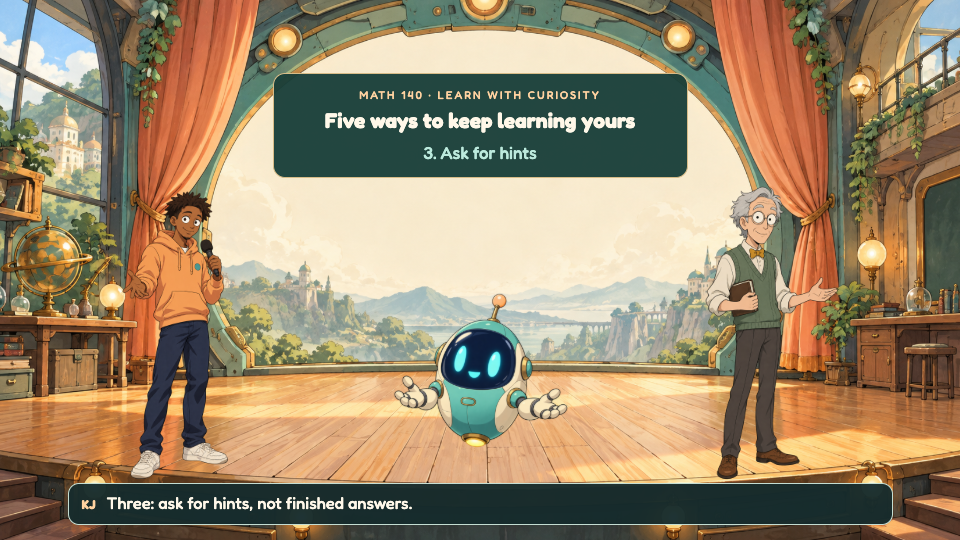
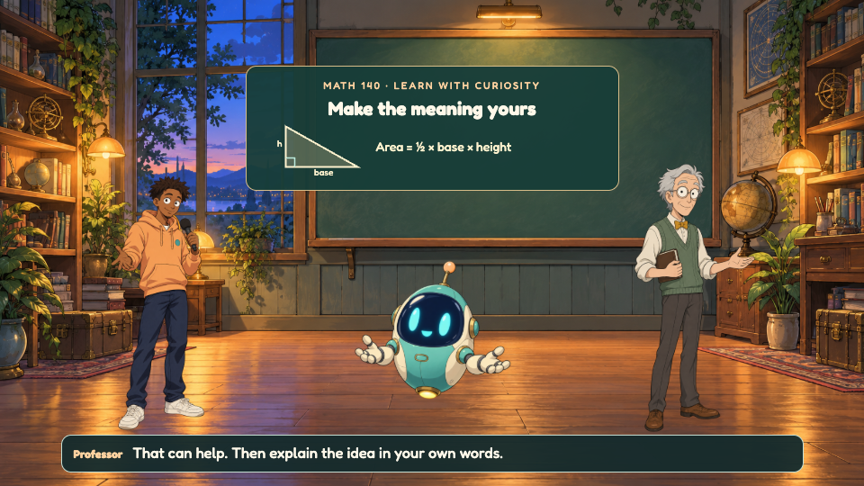
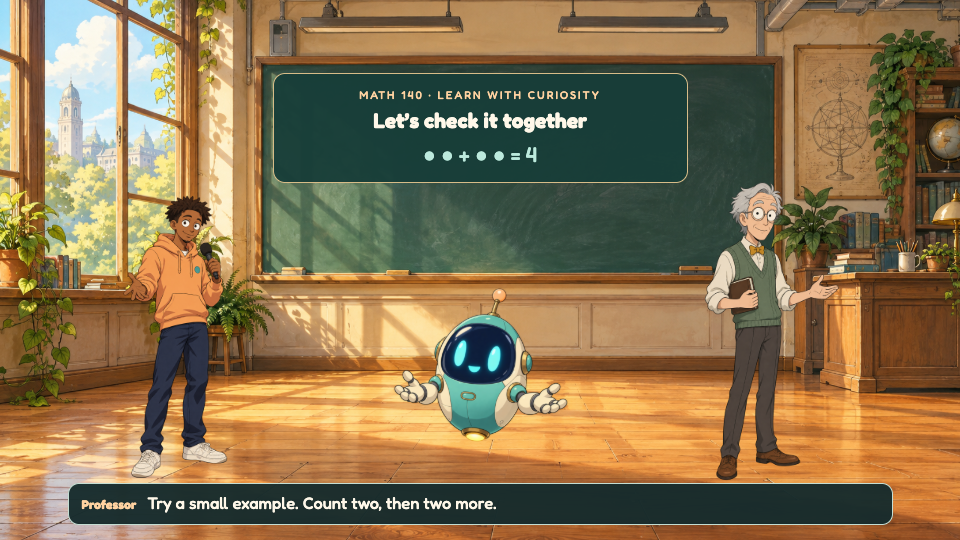
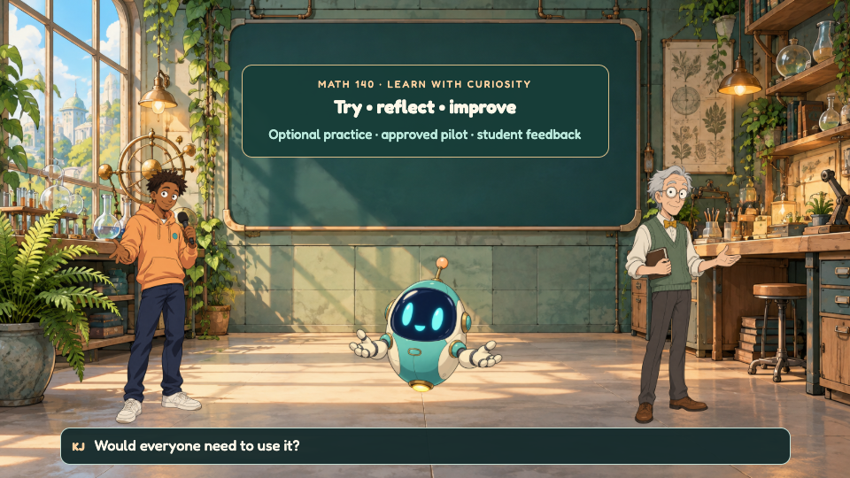
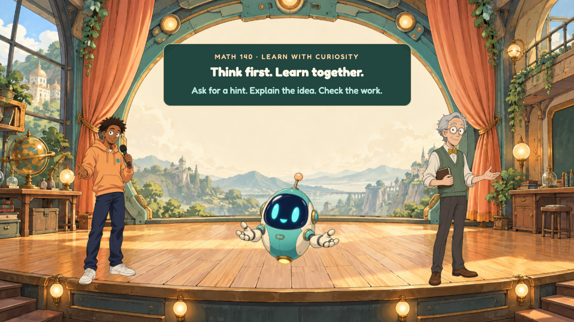

# Math 140 — Your Thinking, Your AI Sidekick (v2)

A friendlier alternate cartoon with expressive original sci-fi characters and warm painted anime settings. New KJ, Professor and B.O.T. artwork, a rewritten 39-line script, six scenes, a VoiceStudio speech adapter, and independent Remotion and HyperFrames assemblies.

**Production status:** artwork and visual blocking are ready for review. VoiceStudio speech, animated facial rigs and the final soundtrack still need the video-finishing pass. The 120-second visual timeline uses estimated speech windows. This repo does not yet contain a finished voiced v2 movie.



## Review the new version

```sh
npm install
npm run v2:script:check
npm run v2:check
npm run dev
```

Choose **FriendlyV2** (full visual assembly) or **FriendlyV2-s1** through **FriendlyV2-s6**. These previews are silent until real speech is generated and measured. The default `render` and `produce` commands now target v2 and refuse a final export while audio is missing.

| Classroom | Five learning rules | Cozy study |
|---|---|---|
|  |  |  |
| Checking together | Optional pilot | Learning together |
|  |  |  |

## New voices with VoiceStudio

Use [debpalash/VoiceStudio](https://github.com/debpalash/VoiceStudio). Start its backend and finish engine setup, then save three distinct synthetic voice profiles. Character recipes and audition directions are in `production/v2/script.json`.

Copy `production/v2/voicestudio.env.example` settings into the root `.env` and set the real `VOICESTUDIO_VOICE_KJ`, `VOICESTUDIO_VOICE_PROF` and `VOICESTUDIO_VOICE_BOT` profile IDs. The adapter validates them against `/v1/audio/voices`; OpenAI-style voice aliases are rejected because VoiceStudio maps those aliases to one default voice.

```sh
npm run v2:audio       # VoiceStudio WAVs → Rhubarb cues → measured timing
npm run v2:export      # synchronize portable production assets
npm run v2:render     # readiness gate, then full-HD final export
npm run v2:qa:post    # inspect completed video format, loudness and frames
```

Speech is cached by text, engine and profile ID. V2 does not silently fall back to system voices. Audio goes to `public/audio/v2/`; the original voice files stay separate. Prerequisites: Node.js, FFmpeg/ffprobe and Rhubarb.

## More than Remotion

**HyperFrames:** `videos/friendly-v2` contains a separate 120-second HTML composition with six sub-compositions, shared artwork and timed captions. Run `npm run v2:export` whenever v2 timing changes, then:

```sh
cd videos/friendly-v2
npm run dev
npm run check
npm run render  # also checks that real v2 audio is ready
```

Keep the complete project folder: its painted backgrounds are external assets, not a self-contained single HTML file.

**OpenMontage:** the [character-animation pipeline](https://github.com/calesthio/OpenMontage/blob/main/pipeline_defs/character-animation.yaml) can supply reusable rigs, pose libraries, character review, sound mixing and final assembly. `production/v2/engine-handoff.json` is a portable reference/input packet, not a native OpenMontage checkpoint. Local checkout found at `/Users/kjcornish/OpenMontage`.

The sprites currently have single facial poses. The next agent should build viseme mouth layers and expressive gestures, generate the three VoiceStudio performances and a gentle soundtrack, then review and export the finished video. See [the complete finishing handoff](docs/v2/HANDOFF.md).

## Production sources

- `production/v2/script.json` and `screenplay.md`: new dialogue and course rules.
- `production/v2/art-bible.md`, `image-prompts.json`, `asset-manifest.json`: design direction, built-in ImageGen prompts and checksums.
- `public/art/v2/`: four new background plates and three transparent character sprites.
- `src/v2/`: new Remotion assembly and explicitly estimated/measured timeline.
- `videos/friendly-v2/`: independent HyperFrames project.

## Original version

The original `Main` and `Scene1`–`Scene6` compositions remain available. `npm run render:legacy` and `npm run produce:legacy` use the original production. The original [README and production instructions](docs/v1-README.md), screenplay, SVG rigs, contact sheet and speech are preserved.

UNLICENSED — Math 140 AI Learning Research.
